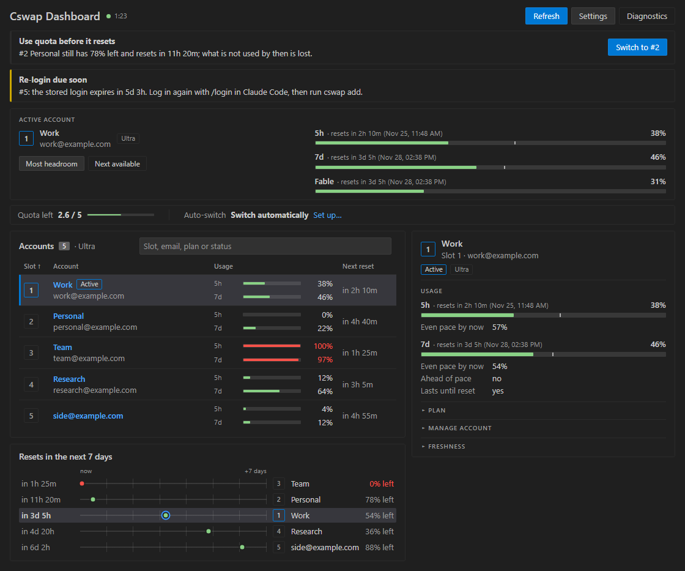

# Cswap Manager

**English** · [Tiếng Việt](README.vi.md)

See the usage of all your Claude accounts at a glance, switch the account Claude Code uses in one click, and let cswap move you to another account when one is used up, without leaving VS Code. Cswap Manager is a graphical front end for [Claude Swap](https://github.com/realiti4/claude-swap) (`cswap`): the `cswap` CLI does all the work, the extension shows its data and runs its commands.

> **Independent project.** Cswap Manager is not affiliated with or endorsed by Anthropic or the authors of claude-swap. You are responsible for using your Claude accounts in line with Anthropic's terms.



## Features
- **Accounts sidebar**: every account's usage per window, time to the next reset and name, lined up in columns.
  ```text
  1 · 5h  38% · 7d  46% · ↻ 2h 10m · Work
  2 · 5h   0% · 7d  22% · ↻ 4h 40m · Personal
  3 · 5h 100% · 7d  97% · ↻ 1h 25m · Team
  4 · 5h  12% · 7d  64% · ↻ 3h  5m · Research
  ```
  The windows are the ones cswap reports for each account, so a plan with only weekly limits shows no 5-hour column, and the menus speak of weekly limits only. With accounts on different plans, an account without a window keeps its column (`5h –`).
- **Status bar**: the active account with a countdown to the next refresh, yellow or red near the limit: `#1 · 5h 38% · 7d 46% · 0:42`.
- **Switch picker and shortcuts**: `Ctrl+Alt+S` lists *Pick automatically*, *Current account*, *Available* and *At limit*, with a usage bar per window and the time to reset; `Ctrl+Alt+Shift+S` switches straight to the next available account.
- **Dashboard**: suggestions with one-click switching, quota left, a sortable account table, a 7-day reset timeline and full account details.
- **Add accounts**: after `/login` in Claude Code, or by pasting a setup-token (`claude setup-token`) or API key, which goes to cswap on standard input only.
- **Automatic switching** with cswap's own `cswap auto`, including **Switch when an account is used up** in one step.
- **Per-project accounts**: tie a folder to an account and open Claude Code with it (`cswap map`, `cswap run`).
- **Another computer**: export and import accounts, or share usage readings between computers.
- **Vietnamese UI** next to English (`cswapManager.language`).

## Getting started
1. Install cswap from [PyPI](https://pypi.org/project/claude-swap/): `uv tool install claude-swap` (or `pipx install claude-swap`). Or let the extension do it: when cswap is missing, **Install cswap…** runs that command in a terminal after you confirm it (installing `uv` first through winget or Homebrew if needed) and refreshes once cswap is there.
2. Install Cswap Manager (see [Install](#install)) and click the Cswap Manager icon in the Activity Bar.
3. Log in to an account with `/login` in Claude Code, then choose **＋ Add Account…** in the Accounts view. Repeat for each account.

The **Get Started with Cswap Manager** walkthrough goes through these steps with buttons: run **Welcome: Open Walkthrough…** from the Command Palette and pick it.

## Requirements
- `cswap` installed and managing at least one account (verified with cswap 1.1.0 and 1.2.0).
- VS Code 1.90 or newer.
- Windows is the primary platform; macOS/Linux should work but are untested.

## Install
- From the Marketplace: search for **Cswap Manager** in the Extensions view, or run `code --install-extension nguyenthanhdat.cswap-manager`.
- From a `.vsix` file (for example a GitHub release): **Extensions** view → `…` menu → **Install from VSIX…**.

The extension finds `cswap` on `PATH` or in `~/.local/bin`. If yours lives elsewhere, set **Cswap Manager › Cli Path** in your user settings to the full path of `cswap.exe`.

## Feature guide

### Accounts sidebar
Click the Cswap Manager icon in the Activity Bar.
- Accounts are listed by slot; the active account is marked and expanded.
- Each account row reads `slot · 7d 40% · ↻ 2d 4h · name`: usage per window and the time until reset, padded so the numbers line up in columns, then the name and (dimmed) the plan. The active account has a green check. Expand an account for per-window bars, per-model scopes, plan and how old the data is.
- **Re-login due** appears (yellow) when an account's stored login expires within 7 days, and in red once it has lapsed — the same 7-day window cswap uses. To renew, log in to that account with `/login` in Claude Code, then run `cswap add`. The dashboard always shows the exact expiry date.
- While automatic refresh runs, the view's title shows the active slot and counts down to the next refresh (`0:42`); the dashboard header and the end of the status bar item do too (`#3 · 7d 40% · 0:42`; turn the status bar one off under *Quick Settings › Status bar*).
- Toolbar: add account, refresh, switch, open dashboard, settings. Filter, sort and diagnostics are in the `…` menu (a clear-filter button appears while a filter is on).
- Right-click an account to switch to it, show details, or manage it.
- **Display names**: *Set Display Name…* gives an account any name (capitals, spaces, accents), shown everywhere instead of the email. It stays in VS Code and is never sent to cswap.

### Status bar
Shows the active account, for example `#5 · 7d 40%`. It turns yellow/red near the usage limit and shows a clock icon when the data is out of date. Click it to switch accounts; the ⚙ next to it opens **Quick Settings**. Under **Quick Settings › Status bar** you can pick a ready-made look or tick exactly what to show (usage icon, slot, name, plan, progress bar, percentage, time to reset), choose how warnings are coloured, and add Refresh / Dashboard buttons. Changes preview live on the status bar before you save them. Right-clicking the status bar shows one **Cswap Manager** entry that hides or shows all Cswap items together.

### Switching accounts
**Cswap: Switch Account…** (or click the status bar) opens a picker arranged by what you most likely want:
1. **Pick automatically** — *Most headroom* (`cswap switch --strategy best`) or *Next available* (`--strategy next-available`).
2. **Current account.**
3. **Available** — accounts below the limit, most remaining quota first.
4. **At limit** — soonest reset first.
5. **Disabled or usage unknown.**

Each account shows a usage bar per window and the time to the next reset; plan, per-model usage and data age are on the second line. Type to filter by slot, email or plan. The buttons in the picker's title bar open **Auto-Switch** and **Quick Settings**.

Shortcuts: `Ctrl+Alt+S` opens the picker and `Ctrl+Alt+Shift+S` switches to the next available account (change them in **Keyboard Shortcuts**).

Switches are confirmed by default; choose **Switch, don't ask again** in the dialog to stop asking (turn it back on under **Quick Settings › Ask before switching**). The extension only reports success after re-reading cswap's state and confirming the new active account.

Switching does not interrupt running Claude Code sessions: cswap replaces the stored login and Claude Code picks it up by itself on its next request, with no restart (per cswap; on macOS with the Keychain this can take up to ~30 seconds).

### Dashboard
**Cswap: Open Dashboard** opens a tab inside VS Code with:
- **Suggestions** with one-click actions, computed from cswap's numbers only: switch before the active account runs out, use quota that resets soon before it is lost, renew logins.
- **Active account**, **Quota left** (in full accounts) and **Auto-switch** cards.
- A searchable, sortable account table and a **7-day reset timeline**; click an account in either to see its details.
- Full details for the selected account (all usage windows, pace and forecast when cswap provides them, last known usage), with plan, settings, freshness and account management folded away. A thin mark on a usage bar is the **even pace** point: the share of that window's time already passed. Usage left of the mark is slower than an even pace.
- **Last 7 days** in the details: a small line of the measured usage of the weekly window (and the limiting one), with "about X per day (measured)" once there are enough readings. Only readings the extension has seen are drawn; nothing is projected.

### Notifications
*Quick Settings › Advanced… › Notifications…* turns each on or off. Each shows once (also across reloads), and only in the VS Code window in front.
- **Usage alert** (`cswapManager.notifyAtUsage`, 90% by default; 80%, 95% or off): while automatic switching is off, the active account reached the alert level in one of its windows. Buttons: **Switch to most quota left**, **Switch automatically when used up**.
- **Login expiry** (`cswapManager.notifyLoginExpiry`, on): three days before an account's stored login expires, and when it has. Log in to it again with `/login`; the extension stores the new login by itself.
- **Weekly reset** (`cswapManager.notifyOnWeeklyReset`, off): an account's weekly limit reset, with **Switch**.

### Managing accounts
From the account's right-click menu, **Cswap: Manage Account…**, or the dashboard:
- **Disable / enable in rotation** — cswap's automatic switching skips disabled accounts; you can still switch to them directly.
- **Set / clear switch threshold** — the usage percentage (50–99.9) at which cswap auto-switch leaves this account. This changes cswap's behaviour.
- **Move to slot** — renumber an account; if the slot is taken, the two accounts trade places.
- **Priority** (0–1000, default 0) — used by the auto-switch strategy *By account priority*: higher first. Read back from `cswap priority` after every change.
- **Remove from cswap…** (right-click menu only) — cswap deletes its stored login, session profile and folder mappings for that account. Your Claude account itself is not affected.
- **Drag and drop** in the sidebar: drop an account onto another one (or any of its rows) to give it that slot; the two trade places. Drop it on the empty space below the list to move it to the end. The list shows the move at once, the changed slot numbers are highlighted briefly, and the result has **Undo**.

Disabling, moving and removing ask for confirmation first. Every change is checked against cswap afterwards.

### Adding accounts
**＋ Add Account…** (the first button of the Accounts view, the last row of the switch picker, or the empty sidebar) asks how:
- **Log in to a new account…** — type `/login` in Claude Code and log in to the new account, then click **I have logged in**. You do not even have to: as soon as the extension sees Claude Code on an account cswap does not manage yet, it offers **Add to cswap…**. Then pick a free slot (the first one is suggested) and confirm; this runs `cswap add`.
- **Paste a setup-token or API key…** (`cswap add-token`) — Claude Code keeps its current login. Create a setup-token with `claude setup-token` in a terminal and paste it into the password box; add an email to recognise the account by if you like (one another account already uses is refused, since cswap would move that account). The token goes to cswap on its standard input only: it is never a command-line argument, never logged and never stored by the extension. cswap cannot read a setup-token account's usage unless **Quick Settings › Usage of token accounts** is on (each reading spends 1 Haiku token, optionally 1 Fable token). An API key is billed per token, and by default cswap auto-switch does not move onto API-key accounts.
- **Refresh the stored login of slot N** — after logging in to the account Claude Code uses again.

**Logging in again** to an account cswap already has (its login expired, is about to, or was refused) needs nothing else: when the extension sees Claude Code on that account with a renewed login, it runs `cswap add --slot N` once to store the new login and tells you (bound to that account: if Claude Code has moved on to another one, cswap cancels without changes). Only the VS Code window in front does this, so several open windows do not repeat it.

Only free slots are offered, so cswap never overwrites another account.

### Per-project accounts
cswap can tie a folder to an account (`cswap map`) and start Claude Code with that account in a terminal (`cswap run`), without changing the account used everywhere else:
- **Assign to a Project Folder…** (account right-click menu, or *Quick Settings › Account for this project*) maps the open folder.
- **Open Claude Code for This Project** (sidebar toolbar `…` menu) starts Claude Code in a terminal with the folder's account.
- **Open Claude Code as This Account…** (account right-click menu) starts it with any account.

**Quick Settings › Chat history across accounts** is cswap's `run.shareHistory`: shared (cswap default) lets every account opened this way see the same conversations (`/resume`); separate keeps each account's own.

The terminal runs `cswap run` directly (no shell). The folder must be trusted (Workspace Trust); on Windows the terminal never runs a `claude` program from the project folder itself. Claude Code must be on `PATH`, and cswap refuses API-key accounts here.

### Another computer
*Quick Settings › Another computer*, or the sidebar `…` menu:
- **Export Accounts to a File…** / **Export This Account to a File…** — `cswap export`. The file holds the logins in plain text, so the extension asks first, warns when the file would land inside the open project, and never opens the file itself (cswap writes it with owner-only access).
- **Import Accounts from a File…** — `cswap import`, confirmed first. Accounts already here are kept unless you choose *Import and Replace Existing* (`--force`).
- **Save Usage Readings for Another Computer…** writes this computer's `cswap list --json` (emails and usage, no logins), and **Import Usage Readings from Another Computer…** feeds such a file to `cswap import-usage`, optionally pausing this computer's own fetching for those accounts for 10 minutes or 1 hour. Computers sharing accounts can so let one of them poll for usage.

### cswap updates
Once a day the extension asks PyPI for the latest claude-swap release. When a newer one exists it **updates cswap by itself, in the background**: it starts the uv or pipx that installed cswap directly (by its full path, without a shell, so a `uv` from a project's virtual environment is never used) with `tool upgrade claude-swap` / `upgrade claude-swap`, after any switch or account change has finished, while holding its own cswap commands. The status bar shows *updating cswap 1.2.0 → 1.3.0…*; afterwards cswap's version is read again, the accounts are refreshed and a notification says *cswap was updated: 1.2.0 → 1.3.0.* Only one VS Code window updates at a time.
- If it fails, a warning gives the exit code and the last line of the installer's error (with emails and your user folder hidden), with **Try again** and **Open in terminal** (the same program and arguments in a terminal that shows their output and stays open). On Windows a running cswap, such as a `cswap run` terminal, can block the update: close it and try again.
- When the installer cannot be told (uv and pipx both hold claude-swap) or found, you get the command to run yourself instead.
- Turn automatic updates off with `cswapManager.autoUpdateCswap` to be asked first (*Update* / *Skip this version*), or the daily check with `cswapManager.checkCswapUpdates`. *Quick Settings › Advanced… › cswap version* checks now and switches both.

Not available in the extension (use the CLI): `purge`, `unclaimed`, `tui`/`watch` and the macOS `menubar`.

### Automatic switching
**Cswap: Auto-Switch…** (also in the sidebar `…` menu, the switch picker and on the status bar while it is on) runs cswap's own auto-switch (`cswap auto --once`) on a schedule while VS Code is open. It is **off by default**.
- **Switch when an account is used up** — one step on and off (also **Cswap: Switch When an Account Is Used Up (On/Off)**): automatic switching at cswap's highest threshold, 99.9%, with the weekly threshold following it, so a session moves to another account instead of stopping at the limit. Checks run every 60 s by default (*Rules… › Check interval*, from 15 s), so one request can still meet the limit just before the switch; Claude Code uses the new account from its next request.
- **Switch automatically, use quota before it resets** — one step to turn on automatic switching with cswap's `consume-first` strategy, so quota that is about to reset gets used instead of wasted.
- **Notify only** — checks regularly with a dry run and tells you when cswap *would* switch, with a **Switch now** button. Nothing is switched.
- **Switch automatically** — cswap switches the active Claude Code account by itself, following the chosen strategy. You confirm once when turning it on, and get a notification for every switch.
- **Strategy…** picks one of cswap's strategies (the extension does not choose accounts itself):

  | Strategy | What cswap does |
  |---|---|
  | Most quota left (`best`, cswap default) | Switches at the threshold, to the account with the most quota left. |
  | Soonest weekly reset, at the limit (`weekly-first`) | Switches at the threshold, to the account whose weekly quota resets soonest. |
  | Use quota that resets soonest first (`consume-first`) | Moves early to an account with quota left whose week resets sooner, so that quota is not wasted. |
  | By account priority (`priority-consume-first`) | Highest account priority first (set with `cswap priority`), then soonest weekly reset. |
- **Per-model limits** (*Quick Settings*) — cswap's `autoswitch.model`: also count one model's weekly limit (for example Fable), or all of them, when picking an account. Applies to *Most quota left* / *Next available* switching and to `cswap auto`.
- **Preview now** shows what cswap would do at this moment (dry run).
- **Rules…** edits cswap's other settings: switch threshold (default 90%), weekly threshold, cooldown (300 s), check interval (60 s), minimum advantage (a target must have at least this many percentage points more quota left, default 10) and failed checks before an account is skipped (default 3). They also apply to `cswap auto` in a terminal.

With several VS Code windows open, only one of them runs the checks. A check never runs at the same time as a manual switch or account change, and is never interrupted halfway.

## Settings
**Cswap: Quick Settings…** (the ⚙ in the status bar, the Accounts view or the switch picker) changes the common settings in the extension's own language: language, ask before switching, the account for this project, refresh interval, auto-switch with its strategy, per-model limits and rules, status bar, progress bar style, usage colours and account order. **Advanced…** holds the rest: chat history across accounts, weekly-reset alerts, usage of token accounts, cswap path and version, command time limit, moving accounts to another computer and **All settings…** (VS Code's Settings page). Each screen has a **← Back** button.

| Setting | Default | Description |
|---|---|---|
| `cswapManager.cliPath` | empty (auto-detect) | Full path to `cswap.exe`. User settings only — a workspace cannot change it. `.cmd`/`.bat` shims are not supported. |
| `cswapManager.language` | `auto` | Language of the extension's UI: `auto` (follow VS Code), `en` or `vi` (Tiếng Việt). Command titles and setting descriptions follow VS Code's display language. |
| `cswapManager.refreshIntervalSeconds` | `120` | Automatic refresh while the sidebar, status bar or dashboard is shown and the window is focused. `0` turns it off; minimum 30. |
| `cswapManager.statusBar.mode` | `slotUsage` | `slotUsage`, `slot`, `nameUsage`, `custom` (see `statusBar.parts`) or `hidden`. |
| `cswapManager.statusBar.parts` | `icon`, `slot`, `usage` | With mode `custom`: any of `icon`, `slot`, `name`, `plan`, `bar`, `usage`, `reset`. |
| `cswapManager.statusBar.colors` | `background` | `background`, `text` (coloured icon/text only) or `none`. |
| `cswapManager.statusBar.buttons` | `settings` | Buttons next to the account: `refresh`, `dashboard`, `settings`. |
| `cswapManager.confirmSwitch` | `true` | Ask before switching accounts. User settings only — a workspace cannot turn it off. |
| `cswapManager.autoSwitch.mode` | `off` | `off`, `notify` (dry runs, tell me) or `switch` (switch automatically). User settings only — a workspace cannot turn it on. |
| `cswapManager.sidebar.sortOrder` | `slot` | `slot`, `mostUsed`, `leastUsed` or `soonestReset`. |
| `cswapManager.display.warningThreshold` / `criticalThreshold` | `80` / `95` | Usage colours only; they do not change cswap. |
| `cswapManager.display.barStyle` | `blocks` | Every usage bar (sidebar, switcher, status bar): `blocks` █░ (eighths of a cell, steps of about 1%), `parallelograms` ▰▱ (eighths too in the switcher, status bar and tooltips, drawn with the extension's own icons; whole cells in the sidebar), `circles` ●○ and `squares` ■□ (half cells, about 5%). |
| `cswapManager.displayNames` | empty | Display names set with *Set Display Name…*, keyed by a hash of the account's identity. Stays in VS Code. |
| `cswapManager.checkCswapUpdates` | `true` | Check PyPI once a day for a newer claude-swap release. |
| `cswapManager.autoUpdateCswap` | `true` | When a check finds a newer cswap, update it in the background without asking (off: ask first). |
| `cswapManager.commandTimeoutSeconds` | `30` | Time limit for reading commands (switching and account changes always get at least 120 s). |
| `cswapManager.maxOutputKilobytes` | `2048` | Maximum CLI output the extension reads. |

## Privacy and security
- No telemetry. The only network request the extension makes itself is the daily version check against `pypi.org` (no data about you or your accounts is sent; turn it off with `cswapManager.checkCswapUpdates`). Everything else is done by `cswap`.
- Usage history stays on this computer (VS Code's storage for the extension): usage percentages and times per account, keyed by a short hash instead of the email, kept for 8 days. Turn it off with `cswapManager.usageHistory`; **Cswap: Clear Usage History** deletes it.
- **Install cswap…** never runs anything without your confirmation; it shows the exact command and runs it in a visible terminal, without piping remote scripts.
- **Automatic cswap updates** (on by default; `cswapManager.autoUpdateCswap`) run without asking, but only `tool upgrade claude-swap` / `upgrade claude-swap` with the uv or pipx that installed cswap, started by its full path without a shell. uv or pipx downloads the release from the package index they are set up to use. Turn it off to confirm each update.
- It never reads Claude Code or cswap credential files. The only token it ever handles is one you paste for **Paste a setup-token or API key…**: it stays in memory for that one command and goes to cswap on standard input, never as an argument, in a log or in settings. Export and import files are written and read by cswap only, and their path is always a real file (never a pipe through the extension).
- `cswap` is started directly (never through a shell), from your home folder, with fixed arguments.
- Logs (**Output › Cswap Manager**) and the diagnostics report contain no CLI output, emails, account IDs or home-folder paths.
- The dashboard runs with a strict Content Security Policy and accepts only a small fixed set of requests.

## Troubleshooting
| Symptom | What to do |
|---|---|
| "cswap was not found" | Install cswap, or set `cswapManager.cliPath` to the full path of `cswap.exe`, then **Refresh**. |
| Path points to a `.cmd`/`.bat` shim | Point the setting at the real `cswap.exe`; shims would need a shell, which the extension does not use. |
| "Stale" / clock icon | The last refresh failed or the data is old. Hover for the reason, then **Refresh**. Older data stays visible but is marked. |
| "list and status disagree about the active account" | cswap reported two different active accounts; run `cswap status` in a terminal. The extension shows the active account as unknown instead of guessing. |
| "Claude Code is logged in to an account cswap does not manage yet" | Add it with **＋ Add Account…** (Accounts view) or `cswap add`. |
| Slanted bars in the sidebar look coarse | Sidebar rows cannot show icons, so **Slanted** draws whole cells there (about 10% each); the switcher, status bar and tooltips show eighths. Pick **Blocks** for steps of about 1% everywhere. |
| "Re-login due" / usage `relogin_required` | The account's stored login expired. Log in to it with `/login` in Claude Code, then run `cswap add`. |
| A switch or change "could not be confirmed" | cswap ran, but the re-read state did not show the expected result. Refresh and check with `cswap list`. |
| Anything else | Run **Cswap: Show Diagnostics** and copy the report; it is safe to share. |

## Known limitations
- The dashboard closes when the window reloads; reopen it with the command.
- Another VS Code window picks up a switch made elsewhere on its next refresh.
- Spend amounts are shown exactly as cswap reports them.
- Only one cswap operation runs at a time; others wait for it to finish.

## License
MIT — see `LICENSE`. Issues and source: https://github.com/ntdatt812/cswap-manager. Development notes: `docs/DEVELOPMENT.md`.
