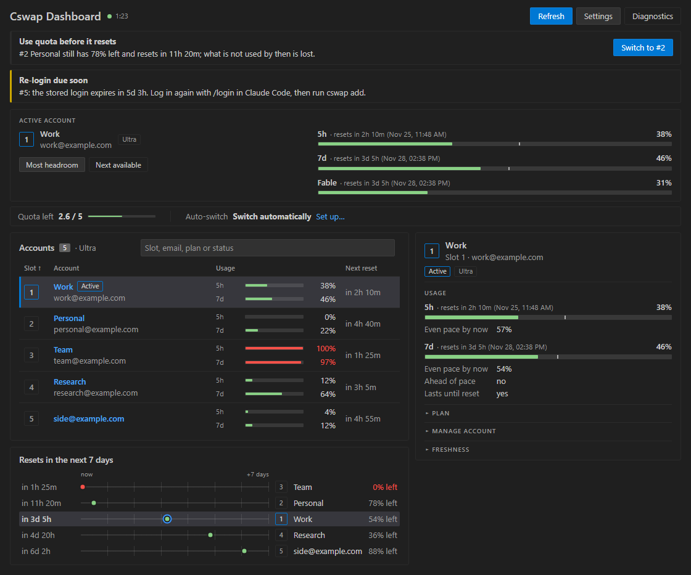

# Cswap Manager

[English](README.md) · **Tiếng Việt**

Xem mức dùng của mọi tài khoản Claude trong nháy mắt, chuyển tài khoản Claude Code đang dùng bằng một cú bấm và để cswap tự chuyển sang tài khoản khác khi một tài khoản hết hạn mức, ngay trong VS Code. Cswap Manager là giao diện đồ hoạ cho [Claude Swap](https://github.com/realiti4/claude-swap) (`cswap`): mọi việc đều do CLI `cswap` làm, tiện ích chỉ hiển thị dữ liệu và chạy lệnh của nó.

> **Dự án độc lập.** Cswap Manager không liên kết với, cũng không được Anthropic hay tác giả claude-swap bảo trợ. Bạn tự chịu trách nhiệm dùng tài khoản Claude của mình đúng điều khoản của Anthropic.



## Tính năng
- **Khung Tài khoản** ở thanh bên: mức dùng từng khung thời gian, thời gian tới lần reset kế tiếp và tên của mỗi tài khoản, thẳng cột với nhau.
  ```text
  1 · 5h  38% · 7d  46% · ↻ 2h 10m · Work
  2 · 5h   0% · 7d  22% · ↻ 4h 40m · Personal
  3 · 5h 100% · 7d  97% · ↻ 1h 25m · Team
  4 · 5h  12% · 7d  64% · ↻ 3h  5m · Research
  ```
- **Thanh trạng thái**: tài khoản đang dùng kèm đếm ngược tới lần làm mới kế tiếp, chuyển vàng/đỏ khi gần chạm giới hạn: `#1 · 5h 38% · 7d 46% · 0:42`.
- **Bảng chọn chuyển tài khoản và phím tắt**: `Ctrl+Alt+S` mở danh sách *Tự động chọn*, *Tài khoản đang dùng*, *Còn dùng được* và *Chạm ngưỡng*, mỗi tài khoản có thanh mức dùng theo từng khung và thời gian tới reset; `Ctrl+Alt+Shift+S` chuyển thẳng sang tài khoản kế tiếp còn dùng được.
- **Bảng điều khiển**: gợi ý kèm nút chuyển một chạm, quota còn lại, bảng tài khoản sắp xếp được, lịch reset 7 ngày tới và chi tiết từng tài khoản.
- **Thêm tài khoản**: sau khi `/login` trong Claude Code, hoặc dán setup-token (`claude setup-token`) hay API key; token chỉ được chuyển cho cswap qua đầu vào chuẩn (stdin).
- **Tự động chuyển** bằng chính `cswap auto` của cswap, có cả **Tự chuyển khi hết hạn mức** bật/tắt bằng một bước.
- **Tài khoản theo dự án**: gán một thư mục với một tài khoản và mở Claude Code bằng tài khoản đó (`cswap map`, `cswap run`).
- **Máy khác**: xuất/nhập tài khoản, hoặc chia sẻ số liệu mức dùng giữa các máy.
- **Giao diện tiếng Việt** bên cạnh tiếng Anh (`cswapManager.language`).

## Bắt đầu
1. Cài cswap từ [PyPI](https://pypi.org/project/claude-swap/): `uv tool install claude-swap` (hoặc `pipx install claude-swap`). Hoặc để tiện ích làm: khi chưa có cswap, **Cài cswap…** chạy đúng lệnh đó trong terminal sau khi bạn xác nhận (cài `uv` trước bằng winget hoặc Homebrew nếu cần) và tự làm mới khi cswap đã có.
2. Cài Cswap Manager (xem [Cài tiện ích](#cài-tiện-ích)) rồi bấm biểu tượng Cswap Manager trên Activity Bar.
3. Đăng nhập một tài khoản bằng `/login` trong Claude Code, rồi chọn **＋ Thêm tài khoản…** trong khung Tài khoản. Lặp lại cho từng tài khoản.

Trang hướng dẫn **Bắt đầu với Cswap Manager** đi qua các bước trên kèm nút bấm: chạy **Welcome: Open Walkthrough…** từ Command Palette rồi chọn nó.

## Yêu cầu
- Đã cài `cswap` và cswap đang quản lý ít nhất một tài khoản (đã kiểm với cswap 1.1.0 và 1.2.0).
- VS Code 1.90 trở lên.
- Windows là nền tảng chính; macOS/Linux có lẽ chạy được nhưng chưa được kiểm.

## Cài tiện ích
- Từ Marketplace: tìm **Cswap Manager** trong khung Extensions, hoặc chạy `code --install-extension nguyenthanhdat.cswap-manager`.
- Từ tệp `.vsix` (ví dụ bản phát hành trên GitHub): khung **Extensions** → menu `…` → **Install from VSIX…**.

Tiện ích tìm `cswap` trên `PATH` hoặc trong `~/.local/bin`. Nếu cswap nằm chỗ khác, đặt **Cswap Manager › Cli Path** trong cài đặt người dùng thành đường dẫn đầy đủ tới `cswap.exe`.

## Hướng dẫn tính năng

### Khung Tài khoản
Bấm biểu tượng Cswap Manager trên Activity Bar.
- Tài khoản xếp theo slot; tài khoản đang dùng có dấu tích xanh và được mở sẵn. Mở một tài khoản để xem thanh mức dùng từng khung, từng model, gói và độ mới của dữ liệu.
- Mỗi dòng có dạng `slot · 7d 40% · ↻ 2d 4h · tên`: các con số được đệm để thẳng cột, sau đó là tên và (mờ) gói.
- **Cần đăng nhập lại** hiện màu vàng khi đăng nhập đã lưu của một tài khoản hết hạn trong vòng 7 ngày, màu đỏ khi đã hết hạn. Để gia hạn: đăng nhập tài khoản đó bằng `/login` trong Claude Code; tiện ích tự lưu đăng nhập mới.
- Khi làm mới tự động đang chạy, tiêu đề khung hiện slot đang dùng và đếm ngược tới lần làm mới kế tiếp (`0:42`); tiêu đề bảng điều khiển và cuối mục trên thanh trạng thái cũng vậy.
- Thanh công cụ: thêm tài khoản, làm mới, chuyển, mở bảng điều khiển, cài đặt. Lọc, sắp xếp và chẩn đoán nằm trong menu `…`.
- Chuột phải vào tài khoản để chuyển sang, xem chi tiết hoặc quản lý. **Đặt tên hiển thị…** đặt cho tài khoản một tên tuỳ ý (chữ hoa, dấu cách, dấu tiếng Việt), chỉ lưu trong VS Code và không bao giờ gửi cho cswap.

### Thanh trạng thái
Hiện tài khoản đang dùng, ví dụ `#5 · 7d 40%`, chuyển vàng/đỏ khi gần giới hạn và có biểu tượng đồng hồ khi dữ liệu đã cũ. Bấm vào để chuyển tài khoản; nút ⚙ bên cạnh mở **Cài đặt nhanh**. Trong **Cài đặt nhanh › Thanh trạng thái** có thể chọn kiểu dựng sẵn hoặc tick đúng những phần muốn hiện (biểu tượng, slot, tên, gói, thanh tiến trình, phần trăm, thời gian tới reset), cách tô màu cảnh báo và thêm nút Làm mới / Bảng điều khiển; thay đổi được xem trước ngay trên thanh trạng thái.

### Chuyển tài khoản
**Chuyển tài khoản…** (hoặc bấm thanh trạng thái, `Ctrl+Alt+S`) mở bảng chọn:
1. **Tự động chọn** — *Còn nhiều quota nhất* (`cswap switch --strategy best`) hoặc *Kế tiếp còn dùng được* (`--strategy next-available`).
2. **Tài khoản đang dùng.**
3. **Còn dùng được** — dưới giới hạn, còn nhiều quota nhất lên trước.
4. **Chạm ngưỡng** — reset sớm nhất lên trước.
5. Tài khoản bị tắt hoặc chưa rõ mức dùng.

Gõ để lọc theo slot, email hoặc gói. `Ctrl+Alt+Shift+S` chuyển thẳng sang tài khoản kế tiếp còn dùng được (đổi phím trong **Keyboard Shortcuts**). Mặc định có hỏi xác nhận trước khi chuyển; chọn **Chuyển, không hỏi lại** để bỏ hỏi (bật lại trong **Cài đặt nhanh › Hỏi trước khi chuyển**). Tiện ích chỉ báo thành công sau khi đọc lại trạng thái của cswap và thấy đúng tài khoản mới.

Chuyển tài khoản không làm gián đoạn phiên Claude Code đang chạy: cswap thay đăng nhập đã lưu và Claude Code tự dùng nó từ yêu cầu kế tiếp, không cần khởi động lại (theo cswap; trên macOS với Keychain có thể mất tới khoảng 30 giây).

### Bảng điều khiển
**Mở bảng điều khiển** mở một tab trong VS Code gồm:
- **Gợi ý** kèm nút bấm, chỉ tính từ số liệu của cswap: chuyển trước khi tài khoản đang dùng cạn quota, dùng quota sắp reset trước khi mất, gia hạn đăng nhập.
- Thẻ **Tài khoản đang dùng**, **Quota còn lại** (tính bằng số tài khoản đầy) và **Tự động chuyển**.
- Bảng tài khoản tìm kiếm và sắp xếp được, **lịch reset 7 ngày tới**; bấm vào một tài khoản để xem chi tiết.
- Chi tiết tài khoản đang chọn: mọi khung mức dùng, nhịp dùng và dự báo khi cswap có cung cấp. Vạch mảnh trên thanh mức dùng là điểm **dùng đều**: phần thời gian của khung đã trôi qua.
- **7 ngày qua** trong phần chi tiết: đường nhỏ vẽ mức dùng đã đo của khung tuần (và khung đang giới hạn), kèm "khoảng X mỗi ngày (đo được)" khi đủ số lần đọc. Chỉ vẽ số đã đo, không dự đoán.

### Thông báo
Bật/tắt từng loại ở *Cài đặt nhanh › Nâng cao… › Thông báo…*. Mỗi thông báo chỉ hiện một lần (kể cả sau khi tải lại cửa sổ) và chỉ ở cửa sổ VS Code đang dùng.
- **Sắp chạm ngưỡng** (`cswapManager.notifyAtUsage`, mặc định 90%; 80%, 95% hoặc tắt): khi chưa bật tự chuyển và tài khoản đang dùng chạm ngưỡng. Nút: **Chuyển sang tài khoản còn nhiều nhất**, **Tự chuyển khi hết hạn mức**.
- **Đăng nhập sắp hết hạn** (`cswapManager.notifyLoginExpiry`, bật): 3 ngày trước khi đăng nhập đã lưu của một tài khoản hết hạn, và khi đã hết hạn. Đăng nhập lại bằng `/login`; tiện ích tự lưu đăng nhập mới.
- **Hạn mức tuần reset** (`cswapManager.notifyOnWeeklyReset`, tắt): kèm nút **Chuyển**.

### Quản lý tài khoản
Từ menu chuột phải, **Quản lý tài khoản…** hoặc bảng điều khiển:
- **Tắt khỏi xoay vòng / Bật lại xoay vòng** — tự động chuyển của cswap bỏ qua tài khoản bị tắt; bạn vẫn chuyển thẳng sang được.
- **Đặt / xoá ngưỡng chuyển** — phần trăm (50–99.9) mà tự động chuyển của cswap rời tài khoản này.
- **Chuyển sang slot** — đổi số slot; nếu slot đã có tài khoản, hai tài khoản đổi chỗ cho nhau. Cũng làm được bằng kéo thả trong khung Tài khoản, có **Hoàn tác**.
- **Độ ưu tiên** (0–1000) — dùng cho chiến lược tự động chuyển *theo độ ưu tiên*.
- **Xoá khỏi cswap…** (chỉ ở menu chuột phải) — cswap xoá đăng nhập đã lưu, hồ sơ phiên và ánh xạ thư mục của tài khoản đó. Tài khoản Claude của bạn không bị ảnh hưởng.

Tắt, chuyển slot và xoá đều hỏi xác nhận trước. Mọi thay đổi được kiểm lại với cswap sau đó.

### Thêm tài khoản
**＋ Thêm tài khoản…** (nút đầu tiên của khung Tài khoản, dòng cuối của bảng chọn chuyển tài khoản, hoặc khi khung đang trống) hỏi cách thêm:
- **Đăng nhập tài khoản mới…** — gõ `/login` trong Claude Code và đăng nhập tài khoản mới, rồi bấm **Đã đăng nhập**. Thật ra không cần bấm: hễ thấy Claude Code ở một tài khoản cswap chưa quản lý, tiện ích tự đề nghị **Thêm vào cswap…**. Sau đó chọn slot trống và xác nhận; việc này chạy `cswap add`.
- **Dán setup-token hoặc API key…** (`cswap add-token`) — Claude Code giữ nguyên đăng nhập hiện tại. Tạo setup-token bằng `claude setup-token` trong terminal rồi dán vào ô mật khẩu. Token chỉ đi tới cswap qua stdin: không bao giờ là tham số dòng lệnh, không ghi log, không được tiện ích lưu lại.
- **Làm mới đăng nhập đã lưu của slot N** — sau khi đăng nhập lại tài khoản Claude Code đang dùng.

**Đăng nhập lại** một tài khoản cswap đã có (đăng nhập hết hạn, sắp hết hạn hoặc bị từ chối) không cần làm gì thêm: khi thấy Claude Code ở tài khoản đó với đăng nhập mới, tiện ích chạy `cswap add --slot N` một lần để lưu lại và báo cho bạn. Chỉ các slot trống được đề nghị, nên cswap không bao giờ ghi đè tài khoản khác.

### Tài khoản theo dự án
cswap có thể gán một thư mục với một tài khoản (`cswap map`) và mở Claude Code bằng tài khoản đó trong terminal (`cswap run`), không đổi tài khoản dùng ở mọi nơi khác:
- **Gán cho thư mục dự án…** (menu chuột phải của tài khoản, hoặc *Cài đặt nhanh › Tài khoản của dự án này*).
- **Mở Claude Code cho dự án này** (menu `…` của khung Tài khoản) và **Mở Claude Code bằng tài khoản này…** (menu chuột phải).

Terminal chạy thẳng `cswap run` (không qua shell). Thư mục phải được tin cậy (Workspace Trust); Claude Code phải có trên `PATH`.

### Máy khác
*Cài đặt nhanh › Máy khác* hoặc menu `…` của khung Tài khoản:
- **Xuất tài khoản ra tệp…** / **Xuất tài khoản này ra tệp…** — `cswap export`. Tệp chứa đăng nhập ở dạng văn bản thường, nên tiện ích hỏi trước, cảnh báo khi tệp nằm trong dự án đang mở và không bao giờ tự mở tệp.
- **Nhập tài khoản từ tệp…** — `cswap import`, có xác nhận trước.
- **Lưu mức dùng để chuyển sang máy khác…** và **Nhập mức dùng từ máy khác…** — chia sẻ số liệu mức dùng (email và mức dùng, không có đăng nhập) để một máy làm việc đọc mức dùng cho các máy khác.

### Cập nhật cswap
Mỗi ngày một lần tiện ích hỏi PyPI bản claude-swap mới nhất. Khi có bản mới hơn, nó **tự cập nhật cswap ở chế độ nền**: chạy thẳng uv hoặc pipx đã cài cswap (theo đường dẫn đầy đủ, không qua shell, nên không bao giờ dùng `uv` trong môi trường ảo của dự án) với `tool upgrade claude-swap` / `upgrade claude-swap`, sau khi mọi thao tác chuyển hay đổi tài khoản đã xong và tạm giữ các lệnh cswap của chính nó. Thanh trạng thái hiện *đang cập nhật cswap 1.2.0 → 1.3.0…*; xong thì đọc lại phiên bản cswap, làm mới danh sách tài khoản và báo *Đã cập nhật cswap: 1.2.0 → 1.3.0.* Mỗi lúc chỉ một cửa sổ VS Code cập nhật.
- Nếu thất bại, cảnh báo cho biết mã thoát và dòng lỗi cuối của trình cài (đã ẩn email và thư mục người dùng), kèm **Thử lại** và **Mở trong terminal** (chạy đúng chương trình và tham số đó trong một terminal hiện kết quả và không tự đóng). Trên Windows, một cswap đang chạy (ví dụ terminal `cswap run`) có thể chặn việc cập nhật: hãy đóng nó rồi thử lại.
- Khi không xác định được trình cài (cả uv lẫn pipx đều có claude-swap) hoặc không tìm thấy nó, bạn nhận được lệnh để tự chạy.
- Tắt tự cập nhật bằng `cswapManager.autoUpdateCswap` để được hỏi trước (*Cập nhật* / *Bỏ qua bản này*), hoặc tắt việc kiểm tra hằng ngày bằng `cswapManager.checkCswapUpdates`. *Cài đặt nhanh › Nâng cao… › Phiên bản cswap* để kiểm tra ngay và bật/tắt cả hai.

Không có trong tiện ích (dùng CLI): `purge`, `unclaimed`, `tui`/`watch` và `menubar` trên macOS.

### Tự động chuyển
**Tự động chuyển tài khoản…** chạy chính `cswap auto --once` của cswap theo lịch khi VS Code đang mở. **Mặc định tắt.**
- **Tự chuyển khi hết hạn mức** — bật/tắt bằng một bước (cũng có lệnh **Bật/tắt tự chuyển khi hết hạn mức**): tự động chuyển ở ngưỡng cao nhất của cswap, 99.9%, để phiên làm việc sang tài khoản khác thay vì dừng ở giới hạn. Mặc định kiểm tra mỗi 60 giây.
- **Tự chuyển, tận dụng quota trước khi reset** — bật tự động chuyển với chiến lược `consume-first` của cswap.
- **Chỉ thông báo** — kiểm tra bằng chạy thử và báo khi cswap *sẽ* chuyển, kèm nút **Chuyển ngay**. Không chuyển gì cả.
- **Tự động chuyển** — cswap tự chuyển tài khoản Claude Code đang dùng theo chiến lược đã chọn; xác nhận một lần khi bật và có thông báo cho mỗi lần chuyển.
- **Chiến lược…**, **Luật…** (ngưỡng, ngưỡng tuần, thời gian nghỉ, chu kỳ kiểm tra…) và **Xem trước ngay** (chạy thử) đều là thiết lập của chính cswap; tiện ích không tự chọn tài khoản.

Khi mở nhiều cửa sổ VS Code, chỉ một cửa sổ chạy kiểm tra.

## Cài đặt
**Cài đặt nhanh…** (nút ⚙ trên thanh trạng thái, khung Tài khoản hoặc bảng chọn chuyển tài khoản) đổi các cài đặt thường dùng bằng ngôn ngữ của tiện ích: ngôn ngữ, hỏi trước khi chuyển, tài khoản của dự án, chu kỳ làm mới, tự động chuyển, thanh trạng thái, kiểu thanh tiến trình, màu theo mức dùng và thứ tự tài khoản. **Nâng cao…** chứa phần còn lại, gồm đường dẫn và phiên bản cswap, thời gian chờ lệnh và **Tất cả cài đặt…**.

| Cài đặt | Mặc định | Mô tả |
|---|---|---|
| `cswapManager.cliPath` | trống (tự dò) | Đường dẫn đầy đủ tới `cswap.exe`. Chỉ cài đặt người dùng, workspace không đổi được. Không hỗ trợ shim `.cmd`/`.bat`. |
| `cswapManager.language` | `auto` | Ngôn ngữ giao diện tiện ích: `auto` (theo VS Code), `en` hoặc `vi`. |
| `cswapManager.refreshIntervalSeconds` | `120` | Làm mới tự động khi khung Tài khoản, thanh trạng thái hoặc bảng điều khiển đang hiện và cửa sổ đang được chọn. `0` là tắt; tối thiểu 30. |
| `cswapManager.statusBar.mode` | `slotUsage` | `slotUsage`, `slot`, `nameUsage`, `custom` hoặc `hidden`. |
| `cswapManager.confirmSwitch` | `true` | Hỏi trước khi chuyển tài khoản. Chỉ cài đặt người dùng. |
| `cswapManager.autoSwitch.mode` | `off` | `off`, `notify` (chỉ thông báo) hoặc `switch` (tự động chuyển). Chỉ cài đặt người dùng. |
| `cswapManager.sidebar.sortOrder` | `slot` | `slot`, `mostUsed`, `leastUsed` hoặc `soonestReset`. |
| `cswapManager.display.warningThreshold` / `criticalThreshold` | `80` / `95` | Chỉ để tô màu, không đổi ngưỡng của cswap. |
| `cswapManager.checkCswapUpdates` | `true` | Mỗi ngày kiểm tra PyPI xem có bản claude-swap mới hơn không. |
| `cswapManager.autoUpdateCswap` | `true` | Khi kiểm tra thấy có cswap mới hơn, tự cập nhật ở chế độ nền mà không hỏi (tắt: hỏi trước). |

Danh sách đầy đủ ở [README tiếng Anh](README.md#settings) và trong trang Settings của VS Code.

## Quyền riêng tư và bảo mật
- Không có telemetry. Yêu cầu mạng duy nhất tiện ích tự gửi là kiểm tra phiên bản hằng ngày tới `pypi.org` (không gửi gì về bạn hay tài khoản; tắt bằng `cswapManager.checkCswapUpdates`). Mọi việc khác do `cswap` làm.
- Lịch sử mức dùng chỉ nằm trên máy này (bộ nhớ của VS Code dành cho tiện ích): phần trăm mức dùng và thời điểm theo từng tài khoản, ghi bằng mã băm ngắn thay cho email, giữ 8 ngày. Tắt bằng `cswapManager.usageHistory`; **Cswap: Xoá lịch sử mức dùng** để xoá.
- **Cài cswap…** không chạy gì khi bạn chưa xác nhận; nó hiện đúng lệnh sẽ chạy và chạy trong terminal bạn thấy được, không chạy script tải từ mạng.
- **Tự cập nhật cswap** (mặc định bật; `cswapManager.autoUpdateCswap`) chạy mà không hỏi, nhưng chỉ chạy `tool upgrade claude-swap` / `upgrade claude-swap` bằng uv hoặc pipx đã cài cswap, theo đường dẫn đầy đủ và không qua shell. uv hoặc pipx tải bản mới từ kho gói mà chúng được cấu hình. Tắt đi để xác nhận từng lần cập nhật.
- Không bao giờ đọc tệp đăng nhập của Claude Code hay cswap. Token duy nhất tiện ích từng chạm tới là token bạn dán vào **Dán setup-token hoặc API key…**: chỉ nằm trong bộ nhớ cho đúng một lệnh và đi tới cswap qua stdin, không bao giờ là tham số, không vào log hay cài đặt.
- `cswap` được chạy trực tiếp (không qua shell), từ thư mục home, với tham số cố định.
- Log (**Output › Cswap Manager**) và báo cáo chẩn đoán không chứa đầu ra CLI, email, mã tài khoản hay đường dẫn thư mục home.
- Bảng điều khiển chạy với Content Security Policy chặt và chỉ nhận một nhóm nhỏ yêu cầu cố định.

## Khắc phục sự cố
| Hiện tượng | Cách xử lý |
|---|---|
| "cswap was not found" / không tìm thấy cswap | Cài cswap, hoặc đặt `cswapManager.cliPath` thành đường dẫn đầy đủ tới `cswap.exe`, rồi **Làm mới**. |
| Đường dẫn trỏ tới shim `.cmd`/`.bat` | Trỏ cài đặt tới `cswap.exe` thật; shim cần shell, mà tiện ích không dùng shell. |
| Dữ liệu "Cũ" / biểu tượng đồng hồ | Lần làm mới gần nhất lỗi hoặc dữ liệu đã cũ. Rê chuột để xem lý do rồi **Làm mới**. Dữ liệu cũ vẫn hiện nhưng có đánh dấu. |
| list và status báo hai tài khoản đang dùng khác nhau | Chạy `cswap status` trong terminal. Tiện ích hiện tài khoản đang dùng là chưa rõ thay vì đoán. |
| Claude Code đang ở tài khoản cswap chưa quản lý | Thêm bằng **＋ Thêm tài khoản…** hoặc `cswap add`. |
| "Cần đăng nhập lại" / mức dùng `relogin_required` | Đăng nhập đã lưu của tài khoản đã hết hạn. Đăng nhập lại bằng `/login` trong Claude Code, rồi chạy `cswap add`. |
| Không xác nhận được việc chuyển hay thay đổi | cswap đã chạy nhưng trạng thái đọc lại không như mong đợi. Làm mới và kiểm tra bằng `cswap list`. |
| Lỗi khác | Chạy **Cswap: Xem chẩn đoán** và chép báo cáo; báo cáo an toàn để chia sẻ. |

## Giới hạn đã biết
- Bảng điều khiển đóng khi cửa sổ tải lại; mở lại bằng lệnh.
- Cửa sổ VS Code khác chỉ thấy việc chuyển tài khoản ở lần làm mới kế tiếp.
- Số tiền chi tiêu được hiện đúng như cswap báo.
- Mỗi lúc chỉ chạy một thao tác cswap; các thao tác khác chờ.

## Giấy phép
MIT — xem `LICENSE`. Báo lỗi và mã nguồn: https://github.com/ntdatt812/cswap-manager.
